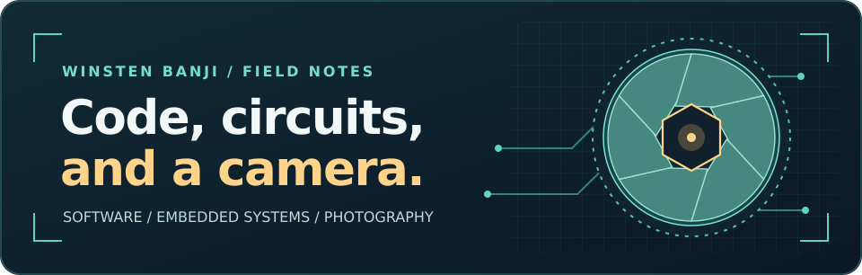

# Winsten Banji

**Cyber Physical Systems student at MIT Manipal** · [LinkedIn](https://www.linkedin.com/in/winsten-banji-1865322aa/) · [Email](mailto:winstenbanji@gmail.com)

I build software that connects sensors, devices, and people. Behind the camera, I look for the details that disappear when you move too fast.

---

## 01 / On the workbench

| Project | What to look for |
| :--- | :--- |
| **[SMART CURE](https://github.com/Winsop/SMART-CURE)** | An ESP32 concrete-curing prototype with a serial bridge and a React dashboard. [See the simulated dashboard and probe-fault demo](https://github.com/Winsop/SMART-CURE#dashboard-demo). |
| **[Number Clash](https://github.com/Winsop/Number-Clash)** | A real-time two-player deduction game with server-validated turns and session recovery. [See the arena and match results](https://github.com/Winsop/Number-Clash#demo). |
| **[Study Ally Pro](https://github.com/Winsop/Study-Ally-2.0)** | A study workspace for subjects, revision, and focus sessions. Co-built with [Shashank B M](https://github.com/shashankbm666). |

## 02 / Toolbox

**Build** · TypeScript · React · Node.js · Python  
**Prototype** · ESP32 · Arduino · Sensor interfacing  
**Explore** · IoT · Digital logic · Signal measurement

<strong>Open the experiment drawer</strong>

- [Modern GUI Calculator](https://github.com/Winsop/Modern-GUI-Calculator) · A Python desktop calculator with a separate expression engine.
- [FocusHelper](https://github.com/Winsop/Web-extension-v2) · A browser extension prototype for reading and focus.
- [Python Projects](https://github.com/Winsop/Python-Projects) · Small exercises from my early Python work.

## 03 / Behind the lens

I photograph the way light lands on ordinary scenes. I was part of the **Photography & Videography** team on the TechTatva ’26 Organising Committee.

| Contact sheet | Frame |
| :--- | :--- |
| **01 / Light** | *A World Pauses Under One Beam of Light* |
| **02 / Reflection** | *Between Shadow and Reflection* |

<!-- Add only photos selected for public display. Keep captions and alt text with each image. -->

## 04 / Find me

[Repositories](https://github.com/Winsop?tab=repositories) · [GitHub activity](https://github.com/Winsop#js-contribution-activity) · [LinkedIn](https://www.linkedin.com/in/winsten-banji-1865322aa/)

> “I am the way, the truth, and the life.” · John 14:6

<!-- Layout inspiration: https://github.com/abhisheknaiidu/awesome-github-profile-readme -->
