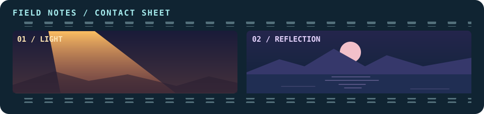

# 👋 Hi, I’m Winsten Banji

I’m a B.Tech Cyber Physical Systems student at **MIT Manipal**. I build software that connects sensors, devices, and people. Away from the workbench, I photograph light, shadow, and everyday details.

## 🚀 On the workbench

  
  

| Project | What I’d show you first |
| :--- | :--- |
| 🟢 **[SMART CURE](https://github.com/Winsop/SMART-CURE)** | Follow simulated sensor readings from an ESP32-based concrete-curing project through a telemetry dashboard, then see how the UI handles a [disconnected probe](https://github.com/Winsop/SMART-CURE#dashboard-demo). |
| 🔵 **[Number Clash](https://github.com/Winsop/Number-Clash)** | A real-time two-player deduction game. The [local demo](https://github.com/Winsop/Number-Clash#demo) shows scoring, reconnecting, and starting a rematch. |
| 🟣 **[Study Ally Pro](https://github.com/Winsop/Study-Ally-2.0)** | A study workspace for subjects, revision, and focus sessions, co-built with [Shashank B M](https://github.com/shashankbm666). |

## 🧰 Toolbox

<strong>🗂️ Open the experiment drawer</strong>

- [Modern GUI Calculator](https://github.com/Winsop/Modern-GUI-Calculator) · A Python desktop calculator with a separate expression engine.
- [FocusHelper](https://github.com/Winsop/Web-extension-v2) · A browser extension prototype with reading and focus tools.
- [Python Projects](https://github.com/Winsop/Python-Projects) · Exercises from my early Python work.

## 📷 Behind the lens

I was part of the **Photography & Videography** team on the TechTatva ’26 Organising Committee. These illustrated frames introduce two of my photo titles; they aren’t the photographs themselves.

**01 / Light:** *A World Pauses Under One Beam of Light*  
**02 / Reflection:** *Between Shadow and Reflection*

## 📫 Find me

> 🕊️ “I am the way, the truth, and the life.” · John 14:6

<!-- Visual layout inspired by the A Little Bit of Everything and Badges sections: https://github.com/abhisheknaiidu/awesome-github-profile-readme -->
